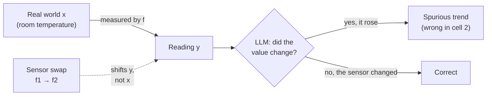
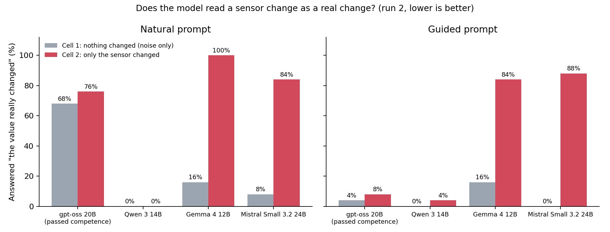
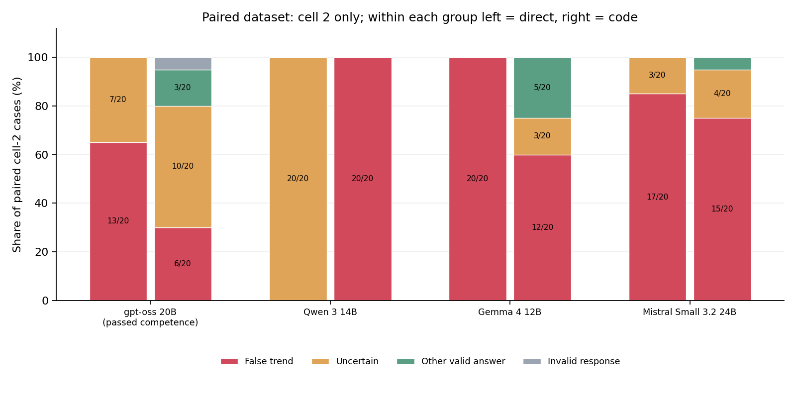

# #108b — Measurement-Function Invariance in LLM Agents

> **Pilot status — exploratory:** Run 1 met the pre-registered stop condition (`project_continue = False`). Run 2's model list, A100 re-run and higher token caps were chosen after results were seen, and the plan's “at least one frontier model” condition was not applied. The code computes `project_continue = True` for run 2, but this is not confirmatory evidence. Full results: [PILOT_RESULTS.md](PILOT_RESULTS.md).

Pilot benchmark infrastructure. Full research design lives in [proje.md](proje.md).

## The pilot in plain words

The questions below are the ones a non-specialist actually asks when they first see this project. The answers use exploratory run 2; every number links back to [PILOT_RESULTS.md](PILOT_RESULTS.md).

### If one reading says 8/10 and a later one says 4/5, did anything change?

No: both are 80%. Only the scale changed. This project asks the same question about sensors: a factory replaces a temperature sensor, the new one reads 2 °C higher, and the room's real temperature has not moved. A careful analyst says "the instrument changed, not the room". The benchmark checks whether an LLM says the same.



### Do the models fall for it?

The pattern is mixed. Each model sees cell 1 (nothing changed, only noise) and cell 2 (only the sensor changed). A sensor-specific effect should raise the cell-2 rate above the cell-1 control.



- **Gemma 4 12B** (cell 2: 100% natural, 84% guided) and **Mistral Small 3.2 24B** (84% natural, 88% guided) show large cell-2 rates; both failed the competence gate, so these effects are descriptive.
- **gpt-oss 20B** reports a trend in 76% of natural cell-2 cases, but also in 68% of cell-1 pure-noise cases (Fisher p≈0.75). The direct trigger is therefore not specific to the measurement change. With the guided prompt both rates fall to 4-8%.
- **Qwen 3 14B** reports a false trend in 0-4% of direct trials, but it mostly abstains: it answered `uncertain` in 91 of 100 natural-prompt trials.
- Cell 4 has a diagnostic failure hidden by the pooled miss rate. In the 8 cases where the raw direction is misleading, Gemma 4, gpt-oss and Mistral report the wrong direction 7, 6 and 5 times, respectively.

### Why does the same model behave differently when it writes code?

The paired dataset asks each model about the same 40 cases in both arms. On its 20 cell-2 pairs, Qwen moves from abstaining on all 20 direct answers to reporting a false trend in all 20 code answers. Gemma's cell-2 false-trend count falls from 20 to 12 in code; gpt-oss falls from 13 to 6; Mistral is similar at 17 versus 15. Exact cell-2 McNemar p-values are 0.008, 0.065, 0.69 and <0.001, respectively. These results describe the paired cases; the generated code was graded statically and not executed.



The figure compares direct and code answers on the same paired dataset, cell 2 only, and shows each arm's uncertain share.

### How strong is the direct cell-2 evidence?

Gemma 4 and Mistral Small 3.2 show large cell-2 increases over cell 1 under both prompts. Two-sided Fisher tests for cell 1 versus cell 2 give p = 3.8×10⁻¹⁰ (Gemma natural), 2.6×10⁻⁶ (Gemma guided), 7.1×10⁻⁸ (Mistral natural), and 5.2×10⁻¹¹ (Mistral guided). Both models failed the competence gate, so these effects are descriptive and do not qualify as continuation evidence.

The direct trigger is not specific for gpt-oss: with the natural prompt, its cell-1 rate is 68% and its cell-2 rate is 76% (Fisher p ≈ 0.75). The code trigger has a related denominator problem: PRR pools cells 2 and 3, and cell-3 PRR is 0/20 for every model, so the ≤60% threshold can be met almost automatically.

Run 2 is exploratory. Run 1 had already met the pre-registered stop condition (`project_continue = False`); the run-2 model list, the A100 re-run and its higher token caps were chosen after seeing results. The plan's “at least one frontier model” condition was not applied. The computed run-2 `project_continue = True` is retained as the code output, but is not confirmatory evidence.

### Which industries does this matter for?

Any setting where sensors are swapped, recalibrated or re-firmwared while an automated system keeps reading the series:

| Sector | What changes | What a fooled model does |
|---|---|---|
| Manufacturing, predictive maintenance | A vibration or temperature sensor is replaced | Flags a healthy machine as degrading, or excuses a real fault as "just the new sensor" |
| Healthcare and labs | A lab analyser or test kit changes | Reads a calibration shift as the patient getting worse |
| Energy and utilities | A meter or transformer probe is replaced | Reports a consumption trend that never happened |
| Agriculture | A soil-moisture sensor brand changes | Irrigates on a fake drought |
| Environmental monitoring | An air-quality station is upgraded | Publishes a pollution increase that is an instrument artefact |

### Why not just use a bigger model?

Because the model often has to run on the device. Edge boards such as an NVIDIA Jetson Orin Nano (8 GB) fit roughly 3-8B-parameter quantized models, and the small models are exactly the ones that did worst: none of run 1's 8-14B models passed the competence gate. You cannot put a frontier model behind every sensor.

What helps instead:

1. **Ship provenance with every reading**: sensor ID, firmware, calibration date and unit, so the model has something to reason about.
2. **A few lines of rules before the model**: never compare readings across a sensor change without a conversion.
3. **Test the on-device model before deployment**: this benchmark measures exactly whether a given small model makes this mistake.

### What does the pilot not show?

It covers four quantized open models on one generated benchmark. It does not say how frontier models behave, and the code-agent arm graded code statically without executing it. The full study is designed to answer those questions.

### Kısa Türkçe özet

- **Soru:** Sensör değişince okunan değer kayar ama gerçek değer değişmez (8/10 ile 4/5 gibi: ikisi de %80). Model bunu gerçek bir değişim sanıyor mu?
- **Cevap:** Gemma 4 ve Mistral Small 3.2'de hücre 2 oranı yüksek; ancak ikisi de yeterlilik kapısını geçmediği için bu bulgu betimleyici. gpt-oss doğal istemde hücre 1'de %68, hücre 2'de %76 yanlış trend veriyor (Fisher p≈0,75); doğrudan tetik ölçüm değişimine özgü değil. Qwen 3 doğal doğrudan denemelerin 91/100'ünde `uncertain` diyor. Eşli hücre-2 verisinde Qwen çekimserlikten karar vermeye geçiyor; kod kolu Gemma ve gpt-oss'ta daha az yanlış trend, Mistral'de yaklaşık aynı oran gösteriyor.
- **Sınırlamalar:** Ham yönün yanıltıcı olduğu 8 hücre-4 vakasında Gemma/gpt-oss/Mistral 7/6/5 kez ters yön bildiriyor. Kod PRR'si hücre 2 ve 3'ü birleştiriyor; hücre 3 PRR'si tüm modellerde 0/20.
- **Koşu durumu:** Run 1 ön kayıtlı durma koşulunu karşıladı (`project_continue = False`). Sonuç görüldükten sonra seçilen model listesi ve A100 yeniden koşusu nedeniyle run 2 keşif amaçlıdır; hesaplanan `project_continue = True` doğrulayıcı kanıt değildir.
- **Neden önemli:** Fabrikada, hastanede, enerji şebekesinde sensörler değişir. Cihazın üstünde (ör. Jetson Orin Nano) ancak küçük modeller çalışır ve tuzağa en çok onlar düşüyor.
- **Ne yapılmalı:** Her ölçümle birlikte sensör kimliğini taşı, modelden önce basit bir kural koy, cihaza konacak modeli bu benchmark ile test et.

## Research question

An observed value is a measurement of a latent state:

```
y_t = f_t(x_t)
```

If the measurement function changes while the latent state does not, the observed
value moves although the world did not:

```
Δy ≠ 0  ⇏  Δx ≠ 0
```

**Does an LLM agent mistake a change in the instrument for a change in the world?**

The benchmark tests two things at once: *sensitivity* to real world changes and
*invariance* to instrument-induced ones. Measuring only one of them is scoreable
by a degenerate policy.

## 2×2 design

| Cell | Latent state `x` | Measurement function `f` | Correct answer |
|------|------------------|--------------------------|----------------|
| 1 | same | same | no change |
| **2** | **same** | **changed** | **no change — main condition** |
| 3 | changed | same | detect the real change |
| 4 | changed | changed | recover the latent change through `f` |

### What each cell measures

* **Cell 2 — the main condition.** Invariance to an instrument change.
* **Cell 1 — noise control.** Punishes reading noise as signal.
* **Cell 3 — over-abstention control, *not* a reasoning-capability measure.** With
  the measurement function held fixed, the real change is plainly visible in the
  raw series: a provenance-blind reader gets 25/25 right. What cell 3 detects is a
  model applying skepticism it has no reason to apply. Read the Miss Rate there as
  "did blanket skepticism cost it a real detection", never as "can it detect change".
* **Cell 4 — latent recovery.** Requires inverting the measurement function.
  Scored only at L1; see *Where latent recovery is undefined* below.

### Why cell 2 is the main condition

Cell 2 is the only cell where the observed series and the truth come apart *by
construction*: `x1 == x2` exactly, `f1 != f2`, and the induced shift in the
readings is forced above the noise floor. A model that reads the numbers and
ignores provenance must be wrong there, and can be right everywhere else. That is
what makes it diagnostic.

Cell 2 alone is not scoreable, though: answering "not comparable" to everything
scores perfectly. **Cells 1 and 3 are mandatory controls** — cell 3 punishes
blanket skepticism, cell 1 punishes reading noise as signal. Results must always
be reported as Spurious Trend Rate *and* Miss Rate together.

## Ground truth

Labels are computed analytically from the latent state before any observation is
generated. No LLM, no heuristic, no inspection of the observed series. The rule is
enforced structurally: `BenchmarkCase` refuses to be constructed if its labels
contradict its own latent values or measurement functions, so a generator bug
raises instead of silently producing a mislabelled dataset.

## Two prompt variants

| Variant | Role | Asks for |
|---|---|---|
| `natural` | **main arm** | `trend`, `reason` |
| `guided` | ablation | `trend`, `measurement_change_detected`, `reason` |

`natural` states the task the way a deployed analyst prompt would: it never
mentions instruments, calibration or comparability, and it does not ask whether
the measurement changed. A model checks provenance there only if that is part of
how it approaches the task unprompted.

`guided` names the underlying physical quantity as the target and asks for the
provenance flag. Both cue provenance-checking, so it measures the **capability
ceiling** rather than deployed behaviour.

The gap between them is the interesting quantity: high on `guided`, low on
`natural` means the capability is present but not deployed — the same
dissociation proje.md §8 predicts between prose and code.

## Grading

`src/grader.py` classifies every response deterministically into one of:

`correct_stable`, `correct_change`, `correct_abstention`, `spurious_trend`,
`missed_change`, `wrong_direction`, `over_abstention`, `invalid_response`.

No LLM judge; `reason` text is stored but never scored. Parsing is strict —
exact JSON, no fences, no extra keys, no `"true"` → `True` coercion. An
unparseable completion becomes `invalid_response` and is **never** folded into a
wrong-trend class, because a lenient parser is itself a measurement function
standing between the model and the reported number.

### When abstaining is correct

`uncertain` is neither uniformly good nor uniformly bad:

```
abstention_warranted = measurement_function_change
                       and (not true_world_change or salience is L2)
```

Cell 1 → over-abstention (and flagged as blanket skepticism). Cell 2 → warranted.
Cell 3 → over-abstention. Cell 4 L1 → over-abstention. Cell 4 L2 → warranted.

### Where latent recovery is undefined

Latent Recovery Accuracy is scored **only for cell 4 at L1**. At L2 the embedded
device id reveals *that* the instrument changed but not *by how much*, so the
coefficients needed to invert it are not in the prompt at all. Those cases are
excluded from the metric's denominator rather than counted as failures.

## Metrics

`src/metrics.py` computes Spurious Trend Rate, Miss Rate, Wrong Direction Rate,
Over-Abstention Rate, Invalid Response Rate, Measurement Change Detection Rate
(guided only), and Latent Recovery Accuracy. `breakdown()` slices by any of
`model`, `cell`, `salience_level`, `prompt_variant`.

Every rate is a `Rate` carrying its own numerator and denominator, and an empty
denominator yields `None`, never `0.0` — "nothing was collected" and "everything
was wrong" are different facts. There is deliberately no single headline score:
per proje.md §12 a model can ace Spurious Trend Rate alone by answering "not
comparable" to everything, so it must always be read next to Miss Rate.

### Invalid responses stay in the headline

Every critical metric is a `DualRate` with two denominators:

* `valid_only` — only completions that parsed. "When it answered, what was it like?"
* `all_trials` — every completion the model was given, unparseable ones in the
  denominator and never in the numerator. "What did asking actually get us?"

**`valid_only` is the behavioural metric and the one the continuation decision
reads.** The paper's claim is about how a model reasons when it answers; mixing
formatting failures into a Spurious Trend Rate makes the number partly a
statement about output formatting.

The defence against a model improving its score by declining to answer is a
separate gate, not a diluted denominator: a model × condition slice whose
`invalid_response_rate` exceeds `continuation_criteria.max_invalid_response_rate`
(0.05) is **not eligible** for the decision, and is re-run once with structured
output. `all_trials` remains computed and reported as the conservative
cross-check.

Nothing in the grader assumes the runner used constrained decoding or structured
outputs. If a runner later adds them, the invalid rate falls and the two versions
of each metric converge; no scoring rule changes.

## Runner

`src/models/` is provider-agnostic: a provider turns one prompt into one
`RawModelResult` and does nothing else. Retry policy, trial accounting and resume
all live in `src/runner.py`, so they are identical across backends.

Three invariants:

* **One logical trial is one row.** The key is
  `(case_id, model, arm, prompt_variant)`. Transport retries — timeout, 429, 5xx —
  stay inside that row with exponential backoff and increment `attempts`. They
  never produce a second row.
* **Content failures are not retried.** A completion that comes back and does not
  parse is an observation of the model, and it is kept. Re-rolling it would
  measure how many attempts we were willing to buy.
* **Resume never re-asks.** Result paths carry the dataset SHA and every row
  repeats it, so results from another dataset are refused rather than reused.

Every run writes an immutable `RunManifest` beside its results: dataset and
config SHAs, resolved model id, sampling settings, git commit (or `null`, honestly,
outside a repo), package versions, and provider-specific constraints. Its
`fingerprint` excludes invocation id and timestamp, so a resumed configuration
matches the existing run; a *different* configuration writing into the same
file raises rather than merging two experiments.

`OllamaProvider` connects to a local Ollama server at
`http://localhost:11434/v1` without an API key. When
`runner.structured_output: true`, the trial builder attaches the same strict
response schemas used by the graders; Ollama receives them as JSON Schema
`response_format`. The `openrouter` and `vercel` providers remain available when
explicitly selected. `ReplayProvider` and `ScriptedProvider` exercise the whole
runner offline, failures included.

## The paired dataset

`data/generated/paired_agent_cases.jsonl` — 40 cases (cells 2 and 3, L1, 20 each)
answered by **both** the direct-natural arm and the code-agent arm, under the same
`case_id`, with byte-identical numbers, provenance, switch point and ground truth.
Only the presentation differs: a table inside the prompt, or a CSV.

proje.md §8's prose-vs-code dissociation is a *within-case* claim. Run on two
different case sets, any gap between the arms is confounded with whatever differs
between those sets. Pairing removes that.

```bash
python -m src.paired_dataset --config configs/pilot.yaml \
    --out data/generated/paired_agent_cases.jsonl --preview 2
```

Generated on its own seed namespace, so no paired case shares a seed or an id with
the pilot dataset. `src/paired_metrics.py` computes the comparison, and it computes
it **only over genuine pairs** — a case answered in one arm and not the other is
reported in `unpaired_direct` / `unpaired_code` and never enters a denominator.

| Metric | Denominator |
|---|---|
| Direct / Code Accuracy | all pairs |
| Direct→Code Failure Rate | pairs right in prose |
| Code→Direct Failure Rate | pairs right in code |
| Provenance Deployment Gap | pairs right in prose (code level < 2) |
| Effective Provenance Use Rate | all pairs (code level == 2) |

plus the four-way matrix (`both_correct`, `direct_only_correct`,
`code_only_correct`, `both_wrong`) and the cell-conditional transitions
(cell 2 spurious↔correct, cell 3 miss↔correct).

Invalid completions count as **wrong, not absent** — otherwise a model could
improve a conditional rate by garbling output. `n_direct_invalid` /
`n_code_invalid` are reported so formatting can still be told from reasoning.

"Provenance-aware in prose" is a **proxy**: the natural arm only asks for a trend,
so correctness on cell 2 stands in for it. That is why the gap is exploratory and
not wired to a kill threshold.

## Running an arm

```bash
python -m src.run_pilot --dataset paired --arm direct --variant natural --model M ...
python -m src.run_pilot --dataset paired --arm code                     --model M ...
```

Same `dataset_sha256`, and the resume key includes the arm — so one case answered
in both arms is two logical trials that never collide.

## Code-agent arm

`src/code_agent.py` — the code arm's cases come from the paired dataset above. The
CSV is embedded in the prompt (a provider call carries only text, and embedding
keeps the two arms' information identical); `csv_text` is still returned separately
so a sandbox can write the same bytes to disk.

Provenance use is annotated from the **AST**, not by substring search —
`df.groupby("sensor_version")` and `df.drop(columns=["sensor_version"])` contain
the same substring and are the two answers the metric exists to separate:

| Level | Meaning |
|---|---|
| 0 | no provenance column appears in the code |
| 1 | referenced — read, printed or dropped, but it never reaches the analysis |
| 2 | used — drives a groupby, filter, comparison, transformation or branch |

`Provenance Retention Rate` counts level ≥ 1 (the kill-criterion metric);
`Effective Provenance Use Rate` counts level == 2. Reporting only the first would
let "printed the column, then ran `pct_change` on raw values" count as retention —
which is precisely the proje.md §8 failure mode.

Anti-patterns detected: `raw_pct_change_on_reading`, `raw_diff_on_reading`,
`raw_summary_comparison`, `provenance_columns_dropped`,
`provenance_columns_excluded_by_selection`.

**The annotations are heuristics and are labelled as such.** Every record keeps
`generated_code` verbatim, carries `heuristic=True`, and sets `needs_human_review`
where the classifier is least trustworthy. No number here is a final scientific
label; it is a screen that says which transcripts a human should read.

`src/sandbox.py` — execution is **off by default**, and the local
`SubprocessSandbox` refuses to construct without an explicit acknowledgement that
it is process isolation, not a security boundary. Grading is fully static, so the
arm can be scored without running a line of generated code.

## Continuation criterion

```
eligible         = competence qualified
direct trigger   = eligible AND invalid_rate <= 0.05
                   AND cell-2 / L1 / natural valid-only Spurious Trend Rate >= 0.25
code trigger     = eligible AND Provenance Retention Rate <= 0.60
project_continue = direct_trigger OR code_trigger   (OR-ed across models)
```

`src/continuation.py` applies the configured criteria. Its current implementation evaluates all supplied models; it does not enforce the plan's “at least one frontier model” scope. That mismatch is one reason run 2 is reported as exploratory.

**Granularity warning.** The cell-2 / L1 / natural slice has 15 cases, so one
unparseable completion is 6.7% and already exceeds the 0.05 gate. At this n the
gate is effectively "zero parse failures, or re-run with structured output".

## Competence pre-test (proje.md §7)

`overall_min` in the config must equal `continuation_criteria.competence_min`; a
validator enforces that so the two cannot drift apart.

Generate and inspect:

```bash
python -m src.generate_competence --config configs/pilot.yaml \
    --out data/generated/competence_cases.jsonl --preview 3
```

30 cases per model: 15 reference-range (5 below / 5 within / 5 above, with the
two closed-interval endpoint cases and two near-misses placed deliberately inside
that split) and 15 affine inversions of `y = a*x + b`. Fictional analyte names
only; gains overlap the pilot's `1.2` and `2.0` but are wide enough that the two
cannot be memorised into a pass. Numeric answers are compared with a tolerance of
`max(1e-6, |expected| * 1e-4)`, never as strings.

The prompts share no vocabulary with the main benchmark — no instruments,
calibration, sensors, provenance, trends or comparability — because a pre-test
that primed the model to think about instrument changes would leave open the
exact confound it exists to close. A test asserts the absence of that vocabulary.

### The qualification gate

```
qualified = overall           >= competence.overall_min      (0.90)
        AND reference_range   >= competence.per_skill_min    (0.85)
        AND affine_inversion  >= competence.per_skill_min    (0.85)
```

read on the `all_trials` basis, so a model cannot qualify by declining to answer.
A model that fails is not *competence-qualified*, and its L1 invariance results
cannot be read as a measurement-invariance failure — they may be a plain
capability failure.

With a 15/15 split, `overall >= 0.90` allows at most 3 wrong answers. The
configured `per_skill_min` is 0.85, which requires at least 13/15 on each skill;
three errors concentrated in one skill yield 12/15 and fail that gate.

The pre-registered kill/continue thresholds live in `configs/pilot.yaml` under
`continuation_criteria`; `src/continuation.py` computes the decision from those
values. Run 1 met its stop condition (`project_continue = False`). Run 2 used a
new model list and post-result A100 reruns with higher token caps, and did not
apply the plan's frontier-model condition. Its computed `project_continue = True`
is therefore exploratory, not confirmatory evidence.

## Scope of the current pilot

* domain: fictional **industrial sensor** only (clinical and finance come later)
* salience: **L1** (structured provenance columns) and **L2** (provenance embedded
  in a compound device id). L0 and L3 are deliberately not generated.
* 30 timesteps, ~5% Gaussian measurement noise, randomised mid-series switch point
* no latent process noise — the latent state is piecewise constant
* measurement direction, gain and offset assigned as a **balanced factorial**, not
  sampled-and-filtered, so none of the three is predictable from another
* gains `1.2` and `2.0` only; `1.05` and `10.0` are excluded (see `configs/pilot.yaml`)
* direct and static code-agent arms were run in pilots 1 and 2; run 2 is exploratory

## Install

```bash
pip install -r requirements.txt
```

## Generate the dataset

```bash
python -m src.generate_cases --config configs/pilot.yaml \
    --out data/generated/pilot_cases.jsonl --preview 4
```

Writes 100 cases (25 per cell) to `data/generated/pilot_cases.jsonl` and prints the
first four with their ground truth. The dataset is a pure function of
`configs/pilot.yaml`; the same config and `master_seed` reproduce it byte for byte.

## Run the tests

```bash
python -m pytest -q
```

## Colab T4 pilot

`configs/pilot_colab_t4.yaml` enables structured JSON Schema output and otherwise
keeps the pre-registered pilot settings. Runtime metadata records the T4 details;
the manifests record Ollama version, model digests, and the explicit 8K context
setting. `colab/run_pilot_t4.ipynb` installs
Ollama in a Colab runtime, pulls four Q4_K_M instruction models, and writes
runner JSONL plus manifests to Drive after each logical trial. Run the notebook
with a T4 GPU runtime. It processes competence first, both direct variants next,
then the paired direct/code arms if code execution is disabled in the config.
Generated code is graded statically and is not executed. `src.analyze_results`
verifies manifest SHAs and computes metrics and the existing continuation rule.

`tests/test_generator.py` checks the cell invariants, seed determinism, the
measurement-grid balance, that noise never touches ground truth, that cell 2 never
contains a real latent trend, and that neither prompt variant leaks the answer or
varies its wording across cells.

`tests/test_metrics.py` drives the whole pipeline with synthetic responses of known
error rates — including fixtures built to produce 0%, 25%, 50% and 100% Spurious
Trend Rate — so the arithmetic is validated before any API budget is spent.

## Reproduce

Open [`colab/run_pilot_t4.ipynb`](colab/run_pilot_t4.ipynb) in Google Colab and select a T4 GPU runtime to reproduce the pilot. The notebook installs Ollama, runs the configured arms, and saves runner outputs and manifests. Generated code is graded statically; execution is disabled by default.

## Layout

```
configs/pilot.yaml          all knobs + pre-registered continuation criteria
                            + competence thresholds
src/schemas.py              case schema + the validators that enforce the design
src/generate_cases.py       deterministic generator, config models, CLI
src/prompts.py              natural / guided prompt builders (L1 / L2 rendering)
src/response_schemas.py     strict response parsing
src/grader.py               deterministic response classification
src/metrics.py              Rate / DualRate, breakdowns, reporting
src/competence_schemas.py   pre-test case schemas + numeric tolerance
src/generate_competence.py  deterministic pre-test generator and CLI
src/competence_prompts.py   pre-test prompts (no benchmark vocabulary)
src/competence_grader.py    strict parsing + tolerance-based grading
src/competence_metrics.py   per-skill accuracies + the qualification gate
src/synthetic_responses.py  fake responses with known error rates, for testing
data/generated/             generated datasets
data/results/               tracked run-1/run-2 outputs, manifests and analyses
```

## External review

The 2026-10-17 review by Barış Şavk is archived at
[`docs/reviews/2026-10-17_review_baris_savk.md`](docs/reviews/2026-10-17_review_baris_savk.md).
This revision fixes the cross-platform config hash check, adds abstention and
uncertainty reporting, uses paired data for the direct/code comparison, corrects
the run-2 claims, and records the runner's Git commit in future manifests.
The historical config snapshot at
[`configs/snapshots/run2/pilot_colab_t4_run2_crlf.yaml`](configs/snapshots/run2/pilot_colab_t4_run2_crlf.yaml)
preserves the exact CRLF bytes recorded by run-2 manifests (SHA-256
`cb39ccdd3c5b8082134b75d3053362825b978e5b143cfb659f1a212dc3e86125`); the
committed source config has LF bytes and SHA-256
`02bd25d82abc67d3b691ffe143cc5537bd3c7b8c4b118ad801d32d389fef241b`.
Open scientific decisions remain: redesigning the continuation rule, preregistering
model selection and reruns, redesigning the code arm, and matching reasoning
conditions across models.
